# python_labs

# Лабораторная работа 5

## Задание A (json <-> csv)
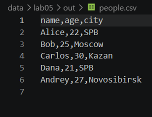
##
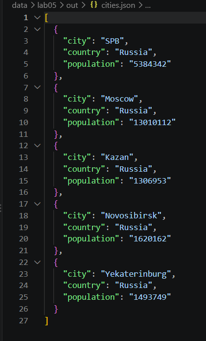

## Задание B (csv -> xlsx)
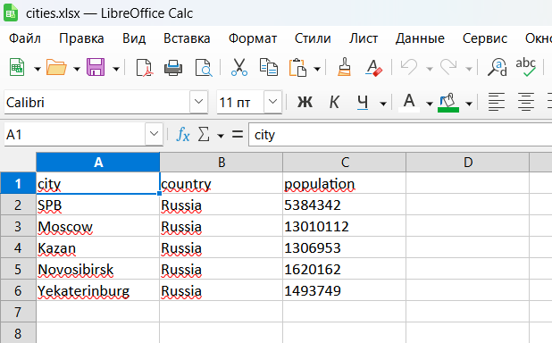

# Лабораторная работа 4

## Задание A
Все тест кейсы запускаются из файла x_test_cases
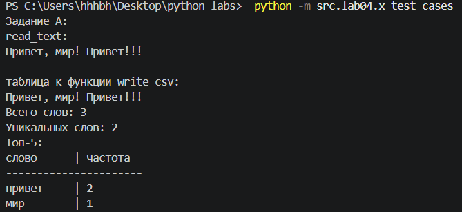
##
В терминал выводится таблица, которую можно включать и выключать, а основной отчет идет в check.csv файл
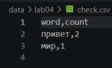

## Задание B
Пустой файл (выводится только заголовок, прописанный вручную)
##
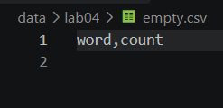

## Задание C
Функция write_csv может работать и с файлами в кодировке cp1251
##
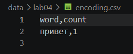

## Задание D

Вывод результата по файлам отдельно
##
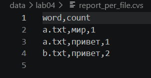
##
Оба файла вместе (для обоих csv отчетов используется одна функция)
##
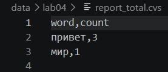

# Лабораторная работа 3
## Задание 1

Здесь лежат тест-кейсы по заданию А
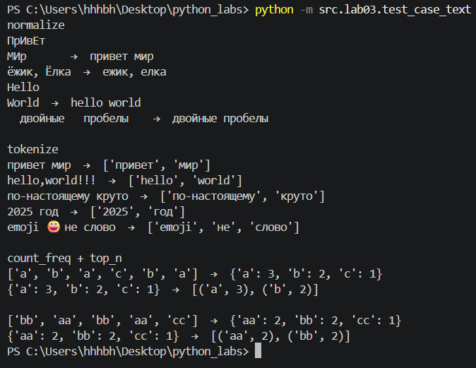

## Задание 2

Переменная k влияет на размер и наличие/отсутствие таблицы в выводе
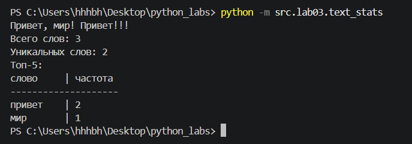

# Лабораторная работа 2
## Задание 1

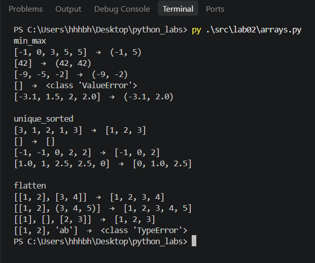

## Задание 2

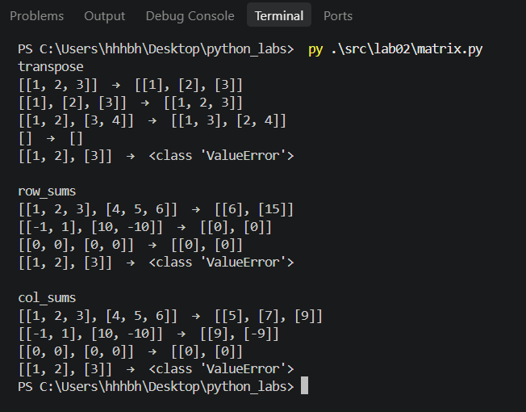

## Задание 3

ValueError выдается в случаях: неверного GPA, неверной длины имени. TypeError выдается в случаях: пустого ФИО, пустой группы, неверного типа ФИО (не буквы)
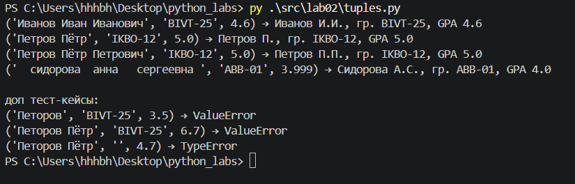

# Лабораторная работа 1
## Задание 1

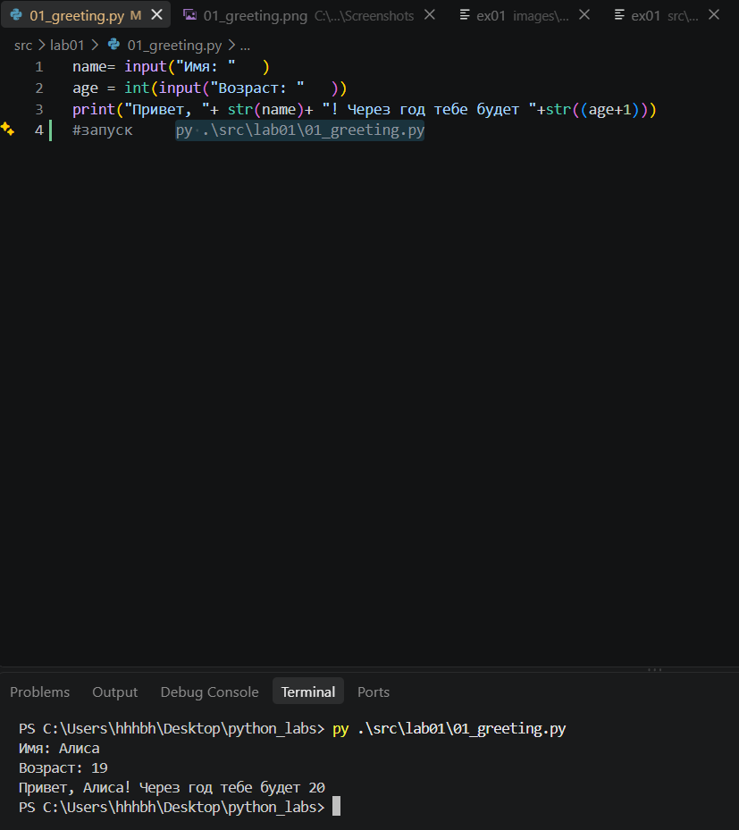

## Задание 2

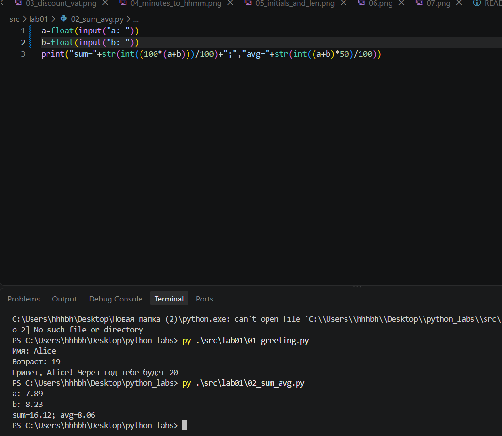

## Задание 3

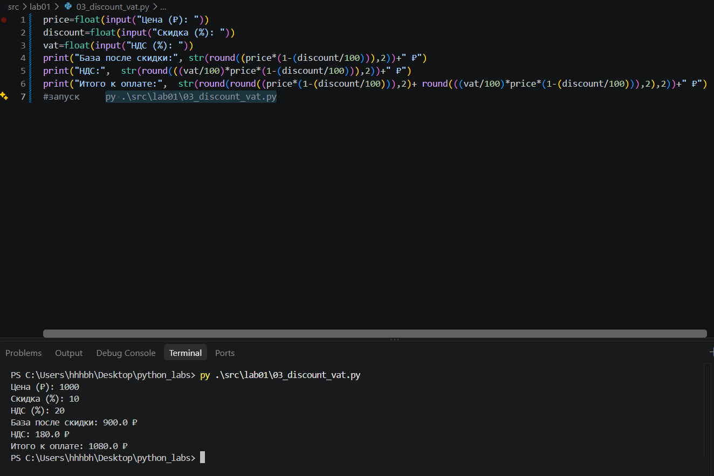

## Задание 4

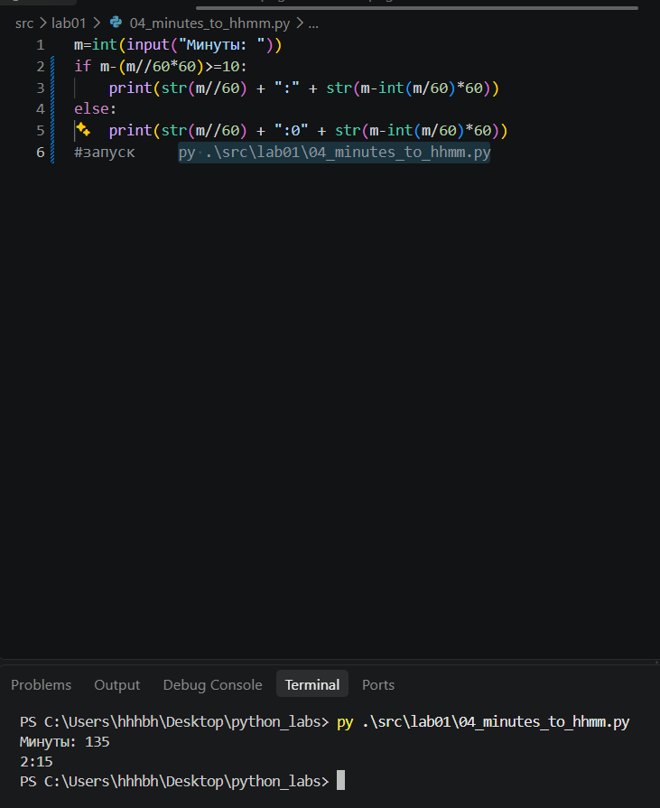

## Задание 5

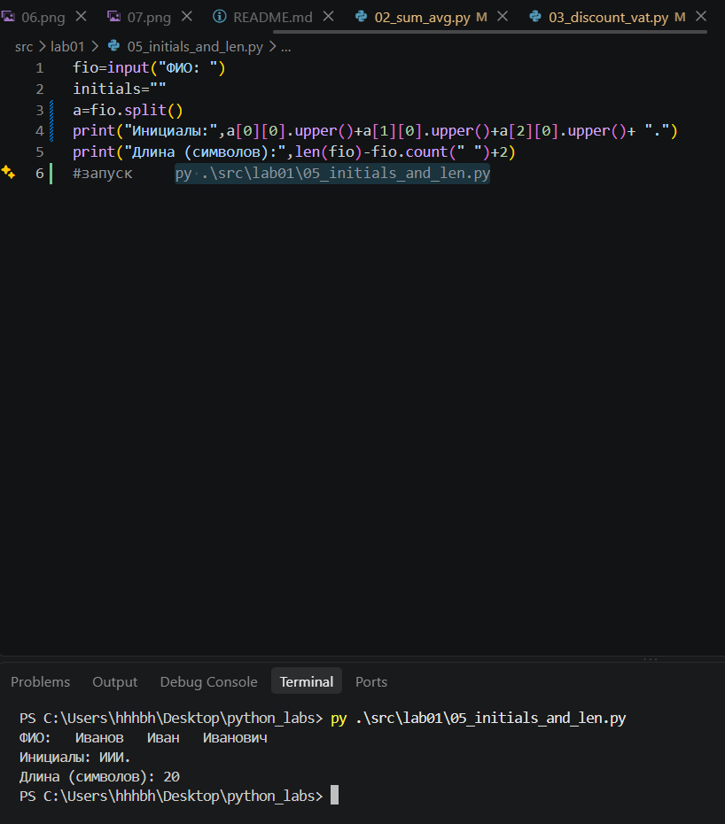

## Задание 6

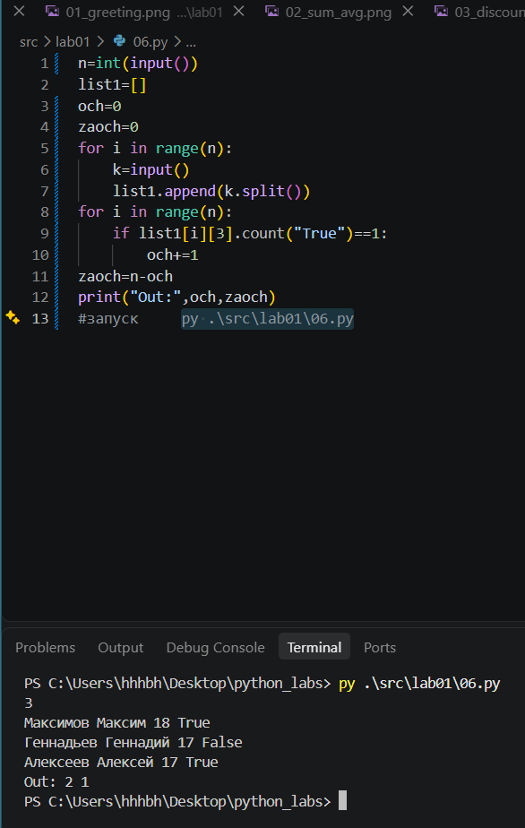

## Задание 7

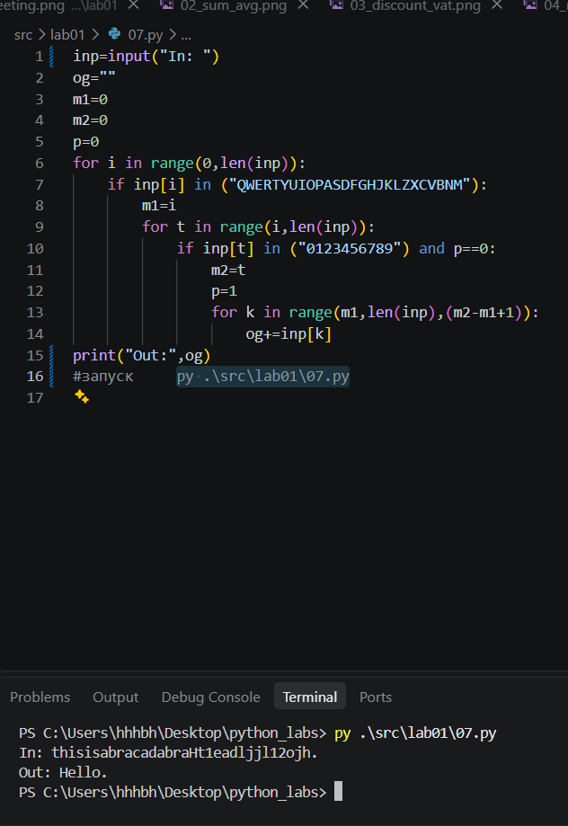

